<div align="center">


<h1>SsPdfEditor</h1>

<p><b>A free PDF editor that runs entirely in your browser.</b><br>
Edit, sign, redact and OCR your PDFs — the file never leaves your device.</p>

<p>
<a href="https://github.com/isolmaz/ss-pdf-editor/actions/workflows/ci.yml?query=branch%3Amain"></a>


</p>

<p><a href="https://pdf.isolmaz.com/editor/"><b>Open the editor</b></a> · <a href="https://pdf.isolmaz.com/">Website</a> · <a href="#quick-start">Run locally</a> · <a href="https://github.com/isolmaz/ss-pdf-editor/issues/new/choose">Report a bug</a></p>

</div>

---

## Features

| | |
| :---: | :---: |
| **Open, navigate, zoom** — thumbnails, outline, tabs<br>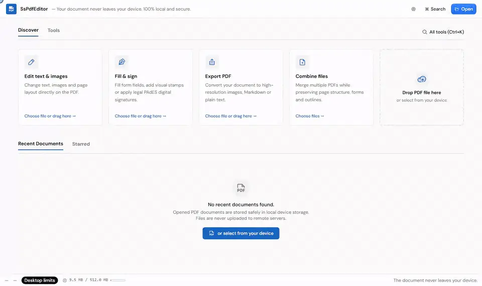 | **Search** — every match, across pages<br>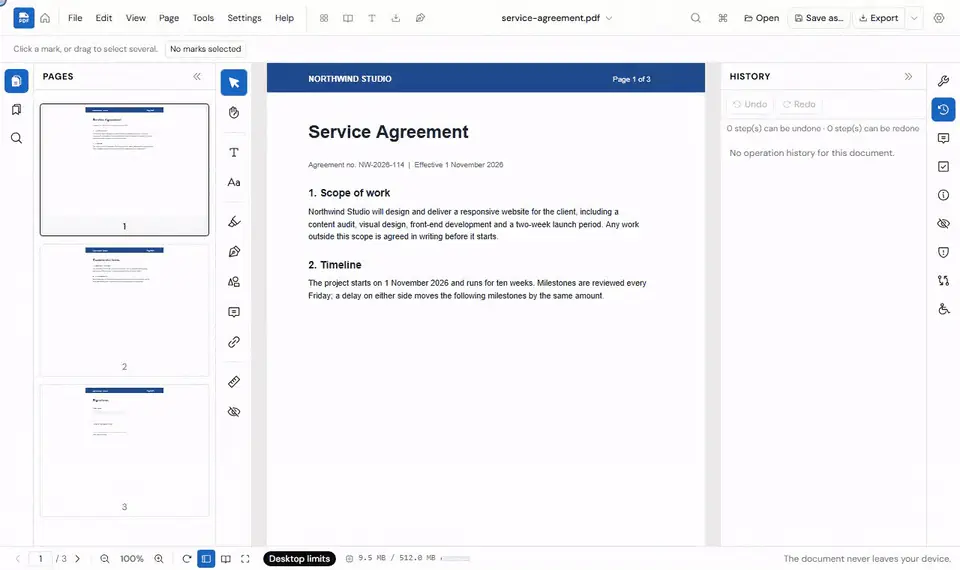 |
| **Mark up** — highlight, shapes, ink, typed text<br>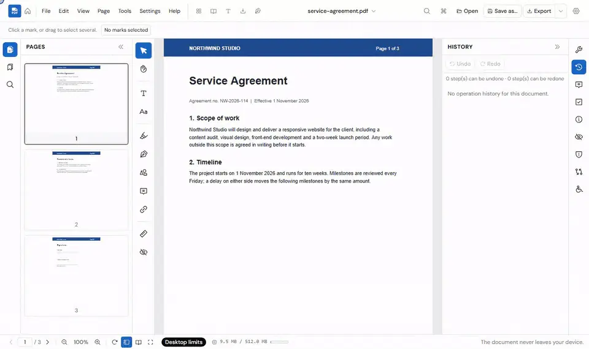 | **Edit text** — retype a paragraph in place<br>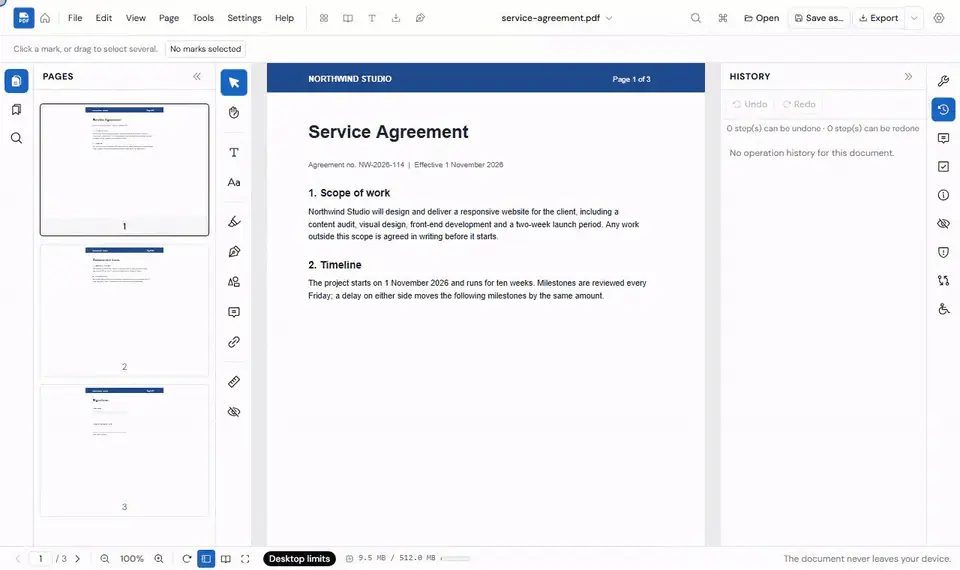 |
| **Organise pages** — rotate, reorder, undo<br>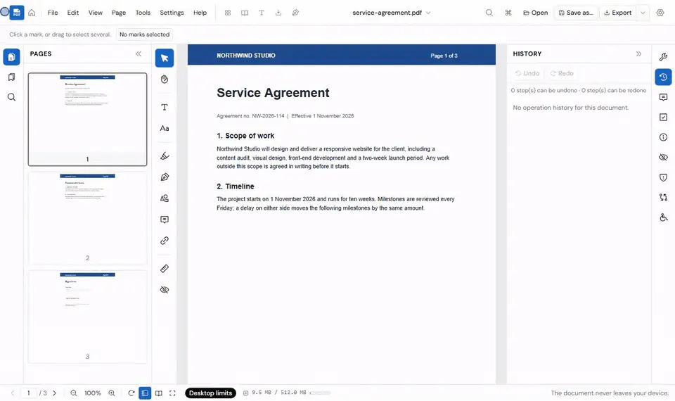 | **Watermark** — stamp every page<br>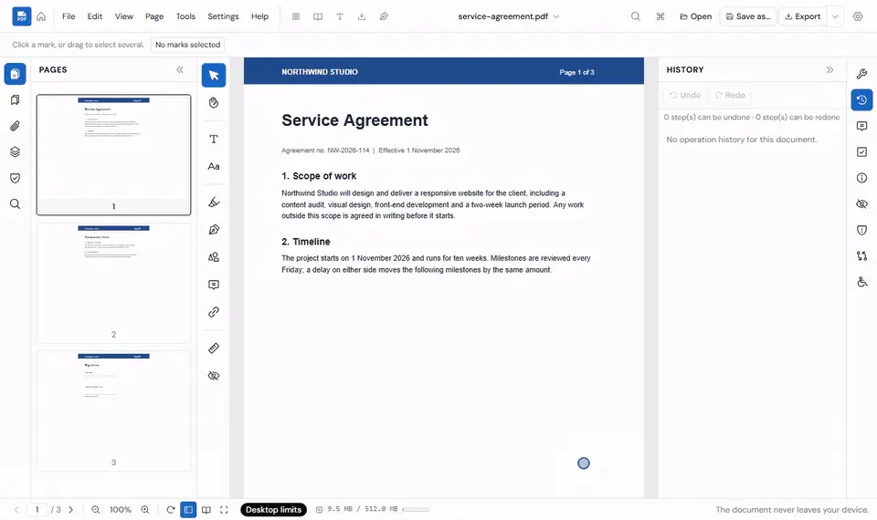 |
| **Fill and sign** — forms and PAdES signatures<br>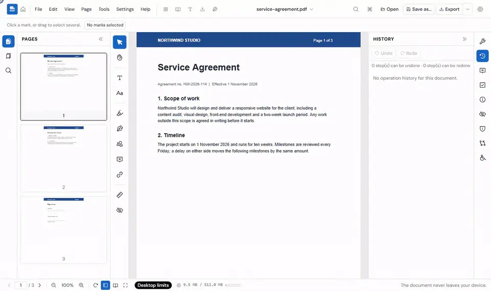 | **Protect** — AES-256 password and permissions<br>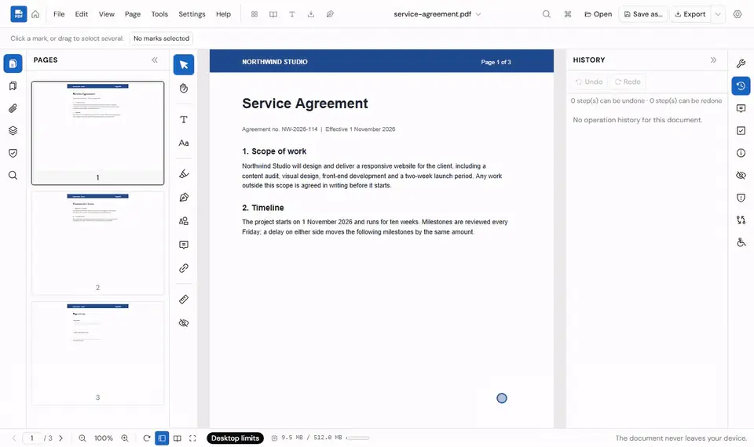 |
| **Redact for real** — content removed, then verified gone<br>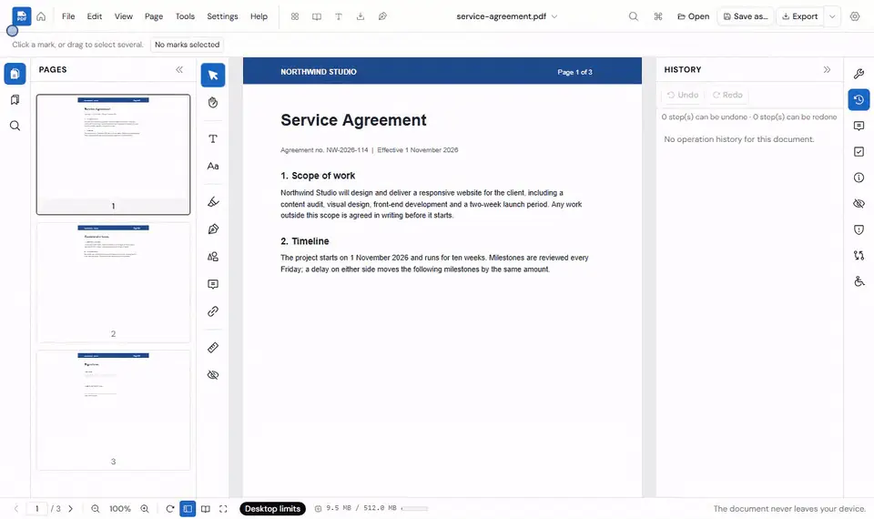 | **OCR** — make a scan searchable<br>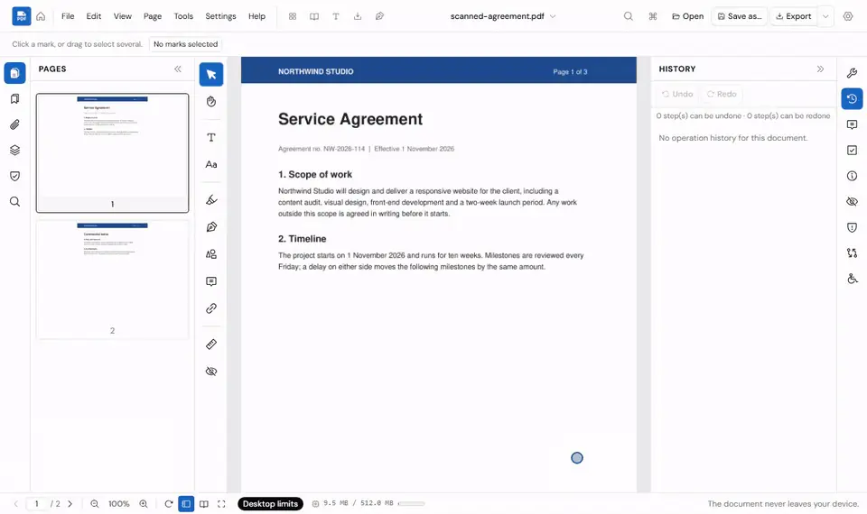 |
| **Measure** — distance, perimeter, area<br>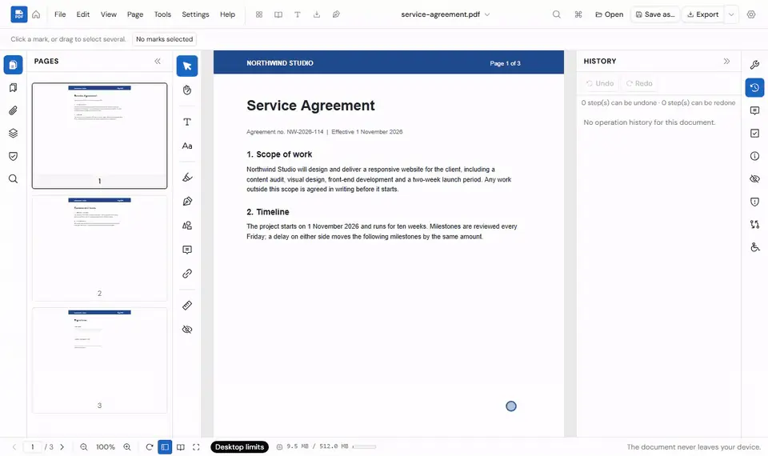 | **Compare** — what changed between two versions<br>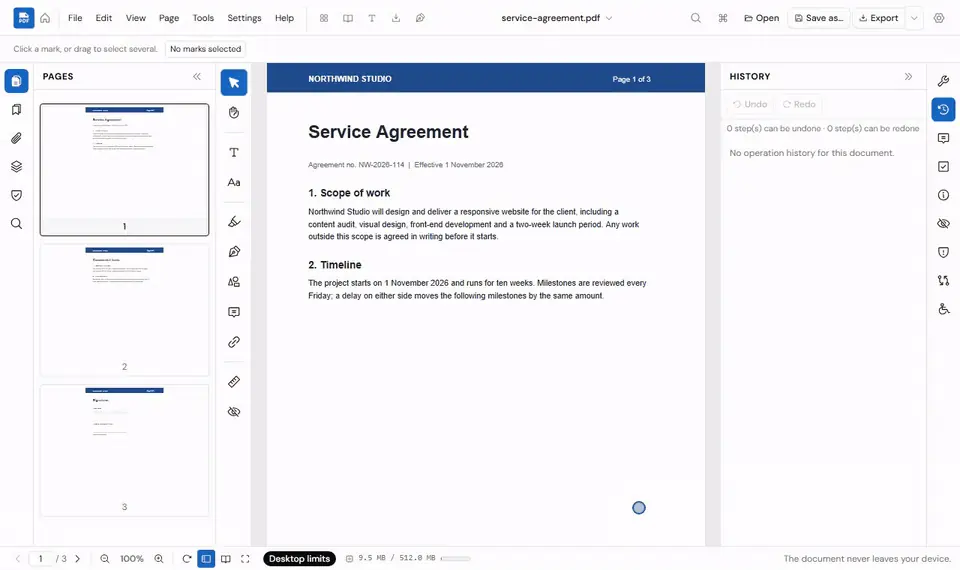 |
| **Reading mode** — the page as clean text, read aloud<br>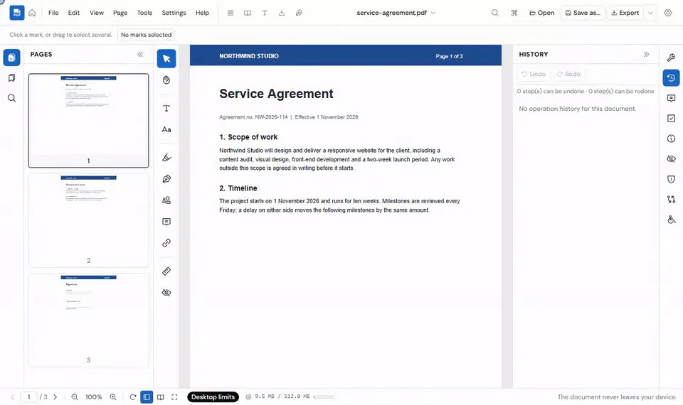 | **Dark theme, Turkish and English**<br>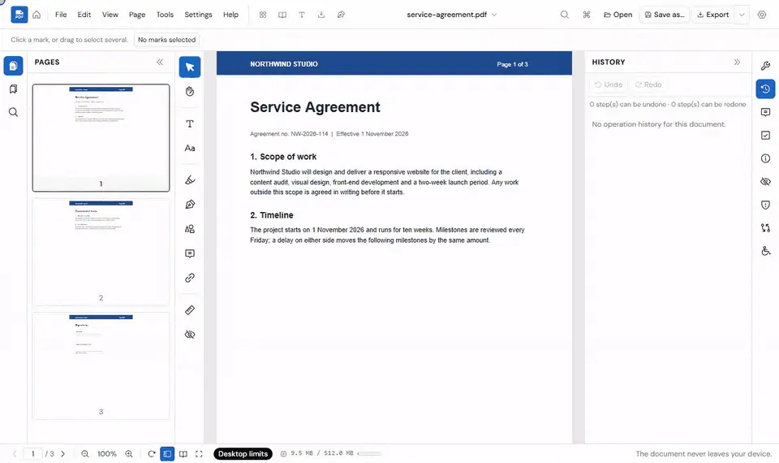 |
| **Command palette and export** — `Ctrl+K` finds any tool<br>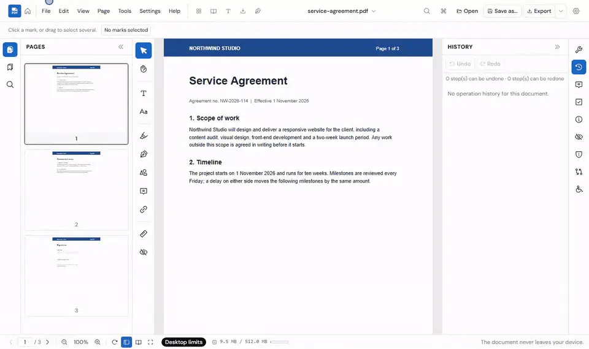 | **And more** — see the full list below ⬇️ |

### Everything it can do

| | |
| --- | --- |
| 📖 **Read** | Continuous scroll · search · thumbnails · outline · tabs · recent files · book and presentation modes · magnifier · snapshot · reading mode with read-aloud |
| ✏️ **Annotate** | Highlight · underline · strike-out · squiggly · ink · shapes · notes · typed text · links · pictures and signatures · move, rotate, resize and delete any mark · comment threads with replies and review status · XFDF, FDF and JSON import and export |
| 📝 **Forms** | Fill · create fields · detect fields on a flat form · flags · flatten · calculations · FDF/JSON import and export · XFA forms (static and dynamic): fill, data in and out, flatten to a normal PDF, remove the XFA |
| 📄 **Pages** | New blank document · insert · delete · duplicate · reorder (page grid) · rotate · extract · split · replace · merge (several files, in any order, or the front and back sides of a double-sided scan alternating) · add a document · reverse order · remove blank pages · split two-up scans · page boxes and auto-crop · straighten tilted scans · labels |
| 🔤 **Text** | Edit in place with reflow · find and replace across the document · export as text or Markdown · pages to images · images to PDF · scan with the camera · Word, Excel, PowerPoint, HTML, text, CSV and EPUB to PDF · PDF to Word, Excel and CSV |
| 🗂️ **Structure** | Outline · attachments · layers · properties and XMP · header/footer · Bates numbering · watermark |
| 🔐 **Security** | True redaction with an audit · sanitize (scripts, attachments, metadata, hidden layers, with a verified report) · AES-256 encryption · remove a password · drawn, typed or photographed signatures and initials · PAdES signing · signature verification with imported CRLs, embedded revocation data and RFC 3161 timestamps |
| 🧰 **Tools** | OCR in 27 languages · accessibility check, PDF/UA check and tags / reading-order editor · alt text · text and pixel comparison · batch processing (up to 256 files per run) · compression · replace, recompress, rotate, crop or fade an embedded image · repair of damaged PDFs · PDF/A conversion and check |
| 🖨️ **Print** | Page ranges · N-up · booklet · poster · duplex sheets |
| ⚙️ **Workflow** | Home screen with every tool by task · `Ctrl+K` palette · undo/redo history · local drafts · save over the original or export a copy · rename the document · simple and advanced modes (chosen in Settings) · offline |

## Quick start

You need **Node ≥ 26** and **pnpm 9.15.9**.

```bash
pnpm install --frozen-lockfile
pnpm fetch:engines --sync   # copies the pinned engines from the pnpm store (no CDN)
pnpm dev                    # http://localhost:5173
```

---

## Contents

1. [Features in detail](#features-in-detail)
2. [Privacy and security](#privacy-and-security)
3. [Document limits](#document-limits)
4. [Honest limits](#honest-limits)
5. [Development](#development)
6. [Quality gates](#quality-gates)
7. [Build and deploy](#build-and-deploy)
8. [Offline use](#offline-use)
9. [Contributing](#contributing)
10. [License](#license)

---

## Features in detail

Every capability below is implemented in this repository. You can reach each one from the
UI: the menu bar, the `Ctrl+K` palette, the tool rail, the docks or the home screen.

The editor starts in **Simple mode**, which keeps the features people reach for most:
opening, merging, converting and saving, organising pages, markup, text editing, forms,
signing and PDF to Word or Excel. The menu bar, the palette, the tool rail and the docks
leave out the rest (redaction, encryption, OCR, measurement, comparison, watermarks, Bates
numbering, compression, layers and attachments among them). **Settings → Interface →
Advanced mode** shows everything, and so does the **Advanced mode** button the palette
offers when a search has matches hidden by Simple mode. The home screen's **All tools**
lists every tool in either mode. The choice is kept on the device.

### Reading and navigation

- **Home screen.** *Start* opens a PDF (or several, each in its own tab: drop them on the
  first tile or click it to choose, the header's **Open** does the same), creates a blank
  document, builds a PDF from images, merges several PDFs in the order you choose (drag the
  files or use their arrow buttons), alternates the front and back sides of a double-sided
  scan (the back sides read from the last page by default, the usual order of a stack turned
  over; pages without a partner follow at the end and the report says so) or starts
  a batch run, and lists recent documents with search, sorting and stars. *All tools* lays
  every tool out by task; pick a tool first and the editor asks for the file when the tool
  needs one. A file that does not open drops the tool, so it never runs on a later document.
- **Viewer.** pdf.js's own viewer stack drives continuous virtualised scrolling, text
  selection and search with match highlighting. With the hand tool a link in the page is
  followed: an internal one goes to its page, an external one opens in a new browser tab, so
  the open document and its unsaved changes stay where they are.
- **View modes.** You get single-page, book and full-screen presentation modes, a
  magnifier lens, and a snapshot tool (**View → Snapshot**, or the palette) that combines the
  pages in view into one PNG to copy or download; marks you have not saved yet are in it.
  - Presentation starts on the page at the top of the viewer and fits it to the screen width.
    Space, `→` and `PageDown` turn to the next page, `←` and `PageUp` to the previous one,
    `Home` and `End` go to the first and last page. `Esc` ends it, and so does the browser
    leaving full screen. A browser that refuses full screen still shows the presentation
    layout in the page. Leaving restores the zoom and the page layout (single or book) you had.
- **Page box.** The status bar's page box goes to the page typed. A number outside the document,
  or text that is not a number, is marked invalid with a short message beside the box (for
  example “Enter 1–5”) and the page stays where it was.
- **Zoom.** `Ctrl+=` and `Ctrl+-` (and the status bar's plus and minus) step through the
  standard levels, 25 · 33 · 50 · 67 · 75 · 90 · 100 · 110 · 125 · 150 · 175 · 200 · 250 · 300 ·
  400 %, from wherever fit width left the page. The percentage in the status bar opens a menu
  with those levels, fit width, fit page and a box for a typed value (25 to 400). The rotate
  button next to it turns the current page in the document; it is one undoable step.
- **Reading mode.** The page is shown as a text column. Read-aloud speaks it a sentence at a
  time, with pause, stop and a speed control, and uses only a speech voice installed on the
  device for the document's own language (the catalog `/Lang`, matched on its primary
  subtag) or, when the file declares none, for the interface language; without such a
  voice it is unavailable and says so.
- **Navigation aids.** Thumbnails, the outline and document tabs. The recent-files list
  reopens a document by its identity, never by its file name: two files with the same name
  are two entries, and opening a file again replaces its earlier entry only when its name, size
  and page count match. In Chromium-based browsers it
  reopens the file itself (the browser asks for permission again, and once more for write
  access the first time you save over it); elsewhere it asks you to choose the file.
- **Rename.** **Edit → Rename** edits the open document's name, shown in the header and on
  its tab.
- **The document never moves under you.** Marks, selections, measurements and staged
  redactions scroll and zoom with their page. Tools, progress and notices never shift
  the page.
- **Password-protected files.** A file that needs a password to open makes the editor ask
  for it, then opens read-only. "Create unlocked copy" opens an editable copy in a new tab,
  and the password is kept in memory only. A file that only an owner password restricts
  opens without a prompt, is stored like any other and keeps its encryption when saved.
- **Menus.** Each menu groups its entries into sections with a rule between them. An entry
  that cannot be used says why when you hover it (for example "Open a document first." or
  "Select a mark first."), and screen readers read the same text. The simple mode has no
  Settings menu, since the header already has a Settings button; the palette still lists it.
- **Shortcut list.** It is available in both languages from Help or `Ctrl+K`, even with no
  document open. The list is the binding table itself, so every chord it prints works.
  `Home`, `End`, `PageUp` and `PageDown` turn the document's page, except while the focus is
  in a menu bar or menu, a list, tree or grid, a tab strip or the form panel's field list:
  those keep the keys to move inside themselves.
- **Tool letters.** A plain letter arms a tool, and the same letter puts it away again: `V`
  select, `H` hand, `E` edit text, `T` add text, `U` markup (highlight, underline, strike-out,
  squiggly: the look used last), `D` freehand draw, `R` shapes, `N` note, `K` link, `M`
  measure, `X` redact. They work only without `Ctrl`, `Alt` or `Shift` held, outside a text
  field, a menu, a list and a dialog, and only on an open document (the tools that write also
  need it to be editable). Each tool's letter is in its rail tooltip and in the shortcut list.
  `F4` toggles the page panel and `Shift+F4` the tools dock; `F5` is the browser's reload.
- **Other shortcuts.** `Ctrl+O` opens, `Ctrl+S` saves, `Ctrl+Shift+S` exports a copy and
  `Ctrl+P` prints; these four and `Ctrl+K` also work while a field has the focus. `Ctrl+Z`
  undoes, `Ctrl+Shift+Z` or `Ctrl+Y` redoes. `Ctrl+0` fits the page to the width and `Ctrl+1`
  shows it at actual size (100 %). `F9` toggles reading mode, `Ctrl+Shift+D` opens the document
  properties. In reading mode `→`, `↓` and `PageDown` turn to the next page, `←`, `↑` and
  `PageUp` to the previous one, and `Esc` leaves it.

### Annotating, forms, measuring

- **Markup.** Highlight (selected text or freehand), ink, notes, underline, strike-out,
  squiggly and geometric shapes are all available. Pictures and signatures are placed as
  stamp annotations (see *Simple signatures and images* below); there are no preset stamps.
- **Add text.** Click and type. The text is written as a `/FreeText` annotation with
  embedded Noto Sans, so Turkish letters survive in every reader. It stays upright on
  rotated pages.
- **One tool rail.** The rail holds every canvas tool: select, hand, edit text, add text,
  markup, ink, shapes, note, link, measure and redact. On a phone it is a toolbar under the
  document that scrolls sideways, and on a touch screen its buttons and the status bar's are
  40 px.
  - The rail, menus, palette, context menu and keyboard all share one armed tool.
  - Text you selected before arming a markup tool is marked at once.
- **One selection for every mark.** This covers session marks, measurements, staged
  redactions and annotations already in the file.
  - Select by clicking, with a marquee or with `Ctrl+A`.
  - Then delete, rotate 90°, drag, or nudge by 5 pt. Every edit can be undone.
  - Selection deletes whole marks only, never page content. To remove page content
    securely, use redaction.
- **Style.** The tool strip sets colour, opacity and thickness for the armed tool. Each tool
  keeps its own style (a translucent yellow marker, solid underline, strike-out, squiggly, pen
  and shape strokes, a yellow note, black typed text, the ruler), so changing the pen's colour
  does not repaint the marker, and the styles are remembered on this device between visits. The
  author a new mark carries is one setting (Settings → Marks), remembered the same way.
  Multiply blending keeps
  text readable, and freehand strokes stay continuous in the exported file. A rectangle,
  circle or line writes its thickness as the annotation's border width (`/BS /W` and
  `/Border`), so other readers draw it and this editor reads the same thickness back.
- **Comment threads.** In the Notes panel every comment can be answered and given a review
  status (Accepted, Rejected, Cancelled, Completed), as in Acrobat.
  - A reply is a real PDF reply (`/IRT`) and a status is a real `/State` record (text
    strings, as the PDF standard defines them), so Acrobat, Foxit and other readers show
    the same thread. Replies and statuses already in a file are listed under their comment.
  - A comment already in the file gets the reply at once, as one undoable step. A comment
    not saved yet keeps it until the comment itself is written.
  - Deleting a comment deletes its replies and statuses with it.
- **Comment exchange.** Comments can be exported and imported as **XFDF** (the XML format
  review tools share), FDF (the comments file Acrobat's “Export comments” writes and reads) or
  JSON (this app's lossless form).
  - XFDF carries the comments already in the file as well as the unsaved ones, with their
    replies and statuses. JSON and FDF carry the unsaved ones.
  - The FDF export is Acrobat's own comment format: one annotation per comment (highlight, underline, strike-out, squiggly, ink, square, circle, line, note, typed text) with its page, position, colour, text, author and date, and each reply and review status as an annotation that answers it.
    Acrobat's own comment files are read the same way, and so are the FDF files this app wrote
    before (`ann.N.*` records). A comment's quarter turn stays in JSON, and a stroke drawn with
    the marker (a highlight painted as a path) leaves FDF and XFDF as ink.
  - Imported comments arrive as unsaved marks that can still be edited. A colour that is not
    `#rrggbb` becomes the default colour and a date that is not a real one (month 13, hour 25)
    becomes the time of the import; a comment on a page the document does not have, or of a
    shape this app cannot draw, is skipped and counted in the notice.
- **Operations apply at once.** Every operation opens in the tools panel. You set it up and
  press *Apply*: a clean result goes straight into the document (or a new tab, or a
  download) and a notice says so — *Ctrl+Z* undoes it, and the notice's *Details* button
  opens the report, with the technical lines folded under *Technical details*. A result that
  lost something, warns of something or only approximates what you asked for is shown first
  as *Review the result*, warnings on top, and its own button applies it. A
  destructive operation asks once before it runs. Pop-up windows are used only for
  decisions that block, such as a password, unsaved changes, a signature warning, export,
  print or settings, plus the XFA form viewer, which needs the room.
- **Save versus Export.** *Save* writes over the file you opened; this needs Chromium
  and its File System Access API, and a document with no file yet asks where to save it
  first. The header's Save button and the Save entry of the menu and the palette are offered
  under the same conditions; where the browser cannot write files there is no Save button
  (`Ctrl+S` downloads there). *Export* always downloads a copy, named as a PDF;
  its dialog shows the size of the document as it is now, not as it was opened. Firefox and
  Safari offer Export only, and there the download is the only way to keep your work, so it
  also counts as saving: the document is no longer marked as having unsaved changes. In
  Chromium an export is a copy and leaves the document as unsaved as it was, except for a
  document a tool produced that nothing has saved yet: its first export counts as its save.
  Saving to a file you pick with *Save as* reads that file once, before the document is
  prepared; it is read again only if its size or modified time changed while the document was
  being prepared. If the file Save would write changed on disk — since it was opened or last
  saved here, or, for a *Save as* target, while the document was being prepared — Save writes
  nothing and asks:
  **Overwrite** replaces that file with your version, **Save as** writes a new file and leaves
  the changed one alone, **Cancel** keeps both. A changed file is never written over without
  that question; only choosing **Overwrite** lets the write go to it unchecked.
- **Forms.** The editor lists the AcroForm fields. You can create fields, set flags,
  flatten them and add simple calculations. Flattening draws each field's value into the
  page: a form another tool filled in (`/NeedAppearances`) is redrawn from its values first
  so nothing is lost, and hidden fields are left out. Calculations read `1.234,56`,
  `1,234.56` and `12,5` as numbers. Form data can be imported or exported as FDF
  or JSON; exporting downloads only the data file. An FDF export writes a checkbox or a
  radio group under the name of its own on-state (`/On`, `/1`, `/Evet`, not always `/Yes`),
  and an FDF import reads fields in any key order, under `/Kids` as `parent.child`, with
  hex or UTF-16 strings; a data file with no readable value is refused instead of reported as
  "0 values applied".
  - **Detect fields** (Forms panel, or `Ctrl+K`) prepares a flat form: it proposes text
    fields, checkboxes, radio groups and signature fields from underlines, dotted leaders,
    boxes, cells, comb boxes, circles and colon labels. Fields are named from the nearest
    label. You see every candidate on the page, remove the ones you do not want and add the
    rest in one undoable step; the result is re-read before it is saved.
- **XFA forms.** A PDF form can carry XFA (Adobe's XML form format) next to or instead of
  its AcroForm. The editor says so in a notice under the tool strip, and what it does
  depends on the kind of form:
  - *Static* XFA (the widgets are in the PDF): filled like any form, and every write also
    updates the XFA data, so Acrobat shows the same values. Filling in place appends that
    update to the file instead of rewriting it, so a signature the form already carries
    keeps covering what it signed. *Remove XFA* keeps only the AcroForm.
  - *Dynamic* XFA (the PDF page is only a "Please wait…" placeholder): *Fill XFA form*
    draws it with pdf.js's XFA renderer in its own window, saves what you typed into the
    form's data, and can export that data as XML. *Flatten to a normal PDF* writes the
    laid-out pages as pictures with an invisible text layer.
  - *XFA data* exports and imports the form's data as the XML file Acrobat's "Export data"
    writes; in a static form the fields are filled from it too.
- **Measurement.** Measure distance, perimeter and area with a scale, units, a grid and
  snapping. The results are written as real PDF annotations. `Esc` clears the chain being
  measured, and a second `Esc` returns to the select tool.
- **Small screens and touch.** Below 1024 px both docks start collapsed and reopen as
  overlays. With the pen, marker, a shape, the link region or redaction armed, a finger drag
  draws instead of scrolling the page; a gesture the browser cancels adds nothing.

### Pages and structure

- **Page operations.** Insert, delete, duplicate, reorder, rotate, extract, split, replace
  and merge.
  - Split cuts by page ranges (one file per range, in the order you type them), every N
    pages, file size, booklet signatures or the bookmarks of the outline (down to a level you
    choose): each part is named after its bookmark, the pages before the first bookmark are a
    part of their own, and a document without bookmarks is told to use another method.
  - The Page menu works on the pages you selected, or on the page on screen when none is
    selected.
  - A new document starts as blank pages of A3, A4, A5, Letter or Legal, in either
    orientation.
  - Merging several files builds a new document in the order you set; its metadata comes
    from the first file, and the report says so.
  - **File → Add document** appends another PDF to the open one, or inserts it at the start
    or after the current page; the result replaces the open document, which keeps its own
    metadata.
  - Outlines, form fields and page labels travel with the pages.
  - *Reverse page order* flips the whole document, or the selected pages among the places they
    hold when two or more are selected. It is one journaled step, undone like any page action.
  - *Remove blank pages* looks for pages with nothing on them and shows their count and
    numbers in the report before anything is removed. A page is kept when it has an
    annotation or form field, any letter or digit of text (visible or not), or more than a
    speck of ink in a small grey render; a scanned sheet with a little noise still counts as
    blank. When no page is blank it says so and changes nothing, and it never removes every
    page.
  - *Split two-up scans* cuts each landscape page in scope into a left and a right page. The
    halves are windows onto the same page content (new media and crop boxes, rotation
    honoured), so nothing is redrawn or re-encoded and the file does not grow by a second
    copy of the scan. Pages that are not landscape, and pages with annotations or form fields,
    stay whole and the report names them. Page labels follow their source page.
  - The Pages panel selects by click, `Ctrl`, `Shift` or the keyboard. It moves the
    selection with `Alt` or `Ctrl` plus the arrow keys, the up and down buttons, the *Move
    to* field or drag and drop, and its toolbar rotates, duplicates, deletes and extracts.
    The toolbar buttons, the *Move to* field and dragging are disabled while the document
    is viewing-only.
  - *Organize pages* (the Page menu, the palette and the home tile) opens every page as a
    large thumbnail in a grid over the editor, for reordering a document at a glance. It
    selects like the Pages panel (click, `Ctrl`, `Shift`, `Ctrl+A`) and has a *Select several*
    mode for a touch screen; drag moves the whole selection to the line shown between two
    pages, `Alt` or `Ctrl` plus the arrow keys (a row for up and down), the move buttons and
    the *Move to* field are the routes without a drag, and the toolbar rotates, duplicates,
    deletes, extracts and inserts. A slider sets the thumbnail size, `Enter` or a double
    click opens a page, and `Escape` or *Back to document* returns. Every change is one undoable
    step; only the pages near the window are drawn, so a 1000-page document stays smooth.
- **Page boxes.** You can edit the Media, Crop, Trim, Bleed and Art boxes. Auto-crop sets
  the box from the ink bounds.
- **Straighten pages.** **Page → Straighten pages** measures how far each scanned page is tilted
  (up to 15° either way, to a few hundredths of a degree on generated pages) and turns the page back.
  - The scan is not re-encoded: a rotation about the page centre is added to the page's content, so the
    picture, an OCR text layer and any vector content turn together, and the page keeps its size and boxes.
  - The report names every page: the tilt removed (`1.8°`), already straight (under 0.1°), skipped for
    having no clear text lines (a blank page, a photograph, a page number) or skipped because the
    turn would push text off the page.
  - Annotations, links and form fields stay where they were. The report counts the turned pages that
    carry any, since they may no longer line up with the content.
  - Undo restores the scan.
- **Structure.**
  - Page labels. Inserting, replacing or merging pages keeps the label every page already had;
    a page from a document without labels is numbered by its page number in that document.
  - Outline editing.
  - Links, limited by a URI allow-list.
  - Attachments: add, save and remove in the Attachments panel; the Properties panel lists
    each one with its size, read from the file, and shows "Size unreadable" for one whose
    data cannot be read.
  - Layers (OCG).
  - Header and footer, Bates numbering and watermarks.
- **Printing.** N-up, booklet and poster imposition, plus a duplex print-sheet builder. Both the browser print and the printable PDF include marks you have not saved yet; the printable PDF draws annotations and form fields into the sheets.
- **Compression.** There are two modes: a structural re-save (lossless), or turning the
  selected pages into images (lossy: their text layer, links and annotations are lost; the
  outline still leads to them).
  If the file grows, the report says so.
- **Repair.** *Repair PDF* (File menu, All tools) takes a damaged file, rebuilds its structure
  from the objects found in it and opens a clean copy in a new tab; the file you picked is
  not changed. The copy is read back (it must open without a repair and hold the same pages)
  and the report says whether the file really was damaged, that content which could not be
  read cannot be restored, and that a digital signature does not survive the rewrite. A file
  that does not open at all points to the tool in its notice.

### Text

- **Text editing with reflow.** Pick a text block and retype it. The editor removes the
  original glyphs and draws the new text in the same box.
  - Editability is measured per block first.
  - A block that cannot be reproduced faithfully is marked **not editable**.
- **Find and replace.** **Edit → Find and replace** (`Ctrl+H`), or **Replace…** in the find
  bar, replaces a text everywhere it occurs, with match case, whole words and a page range.
  The old glyphs are really removed, and the result is checked with a second PDF engine.
  - The new text is drawn where the old one was, at its size and in its colour. When it is
    wider or narrower, the rest of the line moves along; text after a tab stop keeps its
    place. A match across a line break, or one that does not fit its line, lays the
    paragraph out again, and every other word keeps its own font, size and colour. The
    paragraph keeps its alignment (left, centred, right or justified), and the erased area
    stops where the lines above and below begin, so a neighbouring line is not removed with
    the match.
  - It uses the document's own font whenever that font already draws every character the
    new text needs (in a merged file, the copy of the font the page itself uses). Otherwise
    it uses a close standard font (Helvetica, Times, Courier) or Noto Sans, sized to match,
    and the report names the font.
  - Searching without match case, here and in the search panel, treats `I`/`ı` and `İ`/`i` as
    Turkish and English readers expect: `istanbul` finds `İSTANBUL`, and `sık` never matches
    `sik`. A final sigma `ς` and `σ` are the same letter, so `Μαρκος` finds `ΜΑΡΚΟΣ`.
  - Text is compared in its compatibility form, so `m2` also finds `m²`, `fi` finds the ligature
    `fi`, and a full-width `Ａ` finds `A`; every match is replaced, whichever form it was in.
  - A letter and an accent drawn as two glyphs (`e` and U+0301) are compared as the letter
    they make, so `café` finds either spelling, and a match takes the combining marks that
    follow its last letter with it.
  - The new text is one line of words. A line break, a tab or an invisible character in it (a
    zero-width joiner, a soft hyphen, a direction mark) is refused before anything is read,
    and the message names the code points.
- **Export and import.** Export text as plain text or Markdown. Export pages as PNG, JPEG or
  WebP images, or build a PDF from images.
  - Markdown export escapes what Markdown would read as syntax (a line `# of users` stays text
    instead of becoming a heading), so the rendered file shows the page's own words.
- **Other documents to PDF.** DOCX, XLSX, PPTX, HTML, TXT/MD, CSV/TSV, EPUB and FB2 are
  converted in the browser by MuPDF's layout engine. The result is real text you can select
  and search.
  - Opening or dropping such a file converts it and opens the PDF in a new tab; a dropped
    image opens as a PDF page. **File → Convert to PDF** offers the page size, orientation
    and margin, and joins several files into one PDF in the order you set.
  - Word goes through mammoth: headings, lists, tables, links and images. Each Excel sheet
    becomes a table of its used range, with date-formatted cells shown as dates, and each
    slide becomes a page of the slide's size with its text, tables and pictures in reading
    order.
  - Headings become the outline. `http:`, `https:` and `mailto:` links and links inside the
    document become link annotations. The title comes from the file or its name.
  - Text and CSV that open with a UTF-16 byte-order mark (as Notepad and Excel's *Unicode Text*
    save them) are read as UTF-16; other text that is not UTF-8 is read as Windows-1254. The
    report says which.
  - A word with no space that is longer than the line (a URL, a hash, base64) is broken onto
    several lines in text and CSV, in a table cell within the cell's share of the line, so none
    of it runs off the page. Copying it gives the pieces on separate lines.
  - A Word, Excel or PowerPoint file that unpacks to far more than it weighs (a part over 64 MiB,
    or 256 MiB in all) and a CSV with more than 1000 columns or two million cells are refused
    rather than opened.
- **PDF to Word, Excel and CSV.** **Export → Word, Excel or CSV** (also in the tools panel,
  the palette and the home screen) rebuilds the pages in the browser as an editable file. The
  file is read back and checked before it is offered (Word with an independent reader, Excel
  with an XML parser, CSV with a CSV parser), and the report says what was approximated or
  left out.
  - **Word (DOCX)** has three layouts, chosen in the Export dialog: *Text and pictures, exact
    layout* (the default; "Metin + resim, tam düzen" in Turkish) keeps each page's geometry,
    with editable text boxes, shapes and pictures where they sit and the PDF's own fonts
    embedded where their licence allows; *Flowing text* rebuilds paragraphs, headings, tables
    and columns and is the one to edit at length; *One picture per page* draws every page
    exactly as a viewer shows it, but its text cannot be edited in Word. Word's pages stop at
    22 inches a side, so in the exact and picture layouts a larger page is shrunk in
    proportion and the report says which pages and by how much.
  - **Scanned pages.** In the exact layout a scanned page is read with OCR, in the languages
    ticked in the form (default Turkish and English; the 27 OCR languages are offered), and
    becomes editable text over its pictures. Words OCR was less than 90 % sure of get a Word
    comment and are listed in the report. A page that already carries this app's invisible
    OCR layer uses it instead. With no language ticked, or when the engine cannot start, a
    scan stays a picture and the report says so. Why Tesseract and the 90 % threshold:
    [docs/ocr-evaluation.md](docs/ocr-evaluation.md).
  - **Form fields and annotations** are carried in the exact layout as the text or mark the
    page shows; the flowing layout does not carry them, and the report says so. Text the PDF
    itself hides is not exported (the report counts it), except the invisible OCR layer of a
    scanned page.
  - **Excel (XLSX):** one sheet per table, with merged cells; a page without a table becomes
    one sheet of its rows. A value becomes a number only when it reads one way: `1.234,56` and
    `1,234.56` do, but `1.234` and `007` stay text.
  - **CSV:** the same tables in one UTF-8 file, with the separator Excel expects in your
    region. A text cell that starts with `=`, `+`, `-` or `@` would run as a formula when the
    file is opened, so it is written with a leading `'`, and the report counts them.
  - Right-to-left text (Hebrew, Arabic) is exported in reading order, and a Word paragraph of
    right-to-left text is marked as one.
  - How the layouts are built: [`docs/architecture.md`](docs/architecture.md) §5.1.

### Scanning with the camera

**File → Scan with camera** (also on the home screen, in the palette and as a source in
**Insert pages**) turns photographs of a document into a PDF, like a phone scanner app, with
nothing leaving the browser.

- **Camera or files.** The live preview opens the rear camera on a phone and offers a
  camera picker on a laptop; the photograph is taken at the highest resolution the camera
  offers. **Choose photos** takes pictures from files instead, which is also the way on a
  device without a camera or when the camera permission is refused. Denied, missing,
  in-use and insecure-connection cases each say what to do, in Turkish and English, and so
  does a camera that is unplugged or loses its permission while scanning; the shutter waits
  while the camera delivers no picture.
- **The page is found for you.** An outline follows the page in the preview, and the
  photograph is analysed again on capture. A small detector (no OpenCV) finds the page's four
  straight edges even where a finger or glare breaks them. If it is not sure it says so and
  leaves the corners for you to place.
- **Four corners to drag.** A magnifier follows the finger, and the arrow keys move a
  selected corner. The straightened page is shown next to the photograph as you move them.
- **Straightened, not just cropped.** The page is warped to a rectangle, and its shape is
  worked out from the perspective, so a page photographed at an angle comes out as an A4
  page and not a stretched one.
- **Four looks.** Original colour, grayscale, black and white (adaptive threshold, so a
  shadow does not turn half the page black) and **Enhanced** (even lighting, white paper,
  colour kept).
- **Several pages.** Thumbnails to reorder, rotate, delete, retake and re-edit the corners
  of (re-editing the corners of a page ends with **Apply**), then A4, Letter or
  fit-to-image pages and a JPEG quality (low, medium or high). A scan holds at most 40 pages. A photo that cannot be opened is reported, and the
  notice stays while the next photo opens. The PDF opens as a new tab; you are offered the
  OCR tool on it, which makes it searchable. If the PDF cannot be opened (another operation
  is still running, it is over a size or page limit, or opening fails), the scan dialog says
  why and stays open with your pages, and **Create PDF** can be pressed again; no tab is
  opened.
- **Into an open document.** In **Insert pages**, the source **Scan with camera** inserts
  the straightened pages after the page you choose.

### Redaction, security, signing

- **True redaction.**
  - Marked text and the line art under it are removed from the page content, not painted
    over.
  - Form fields and annotations are not removed by the engine, so the writer deletes every
    one whose rectangle meets a mark: a field with its value, a note or other markup with its
    popup and replies, a link. Neither a value nor a note's text stays in the file. A hybrid
    XFA form also keeps each value in its XFA data, so its XFA is dropped when a field goes and
    the form falls back to its AcroForm fields. The report counts the fields and annotations
    that went, and says when the XFA was dropped.
  - The file is rewritten as a single revision, and the output is re-checked glyph by glyph
    and for any annotation or field still under a mark. An object-level audit reports any
    remaining terms, earlier revisions and leftover structure.
  - The engine does not edit text drawn through a tiling pattern or a soft-mask group. A marked
    page whose patterns or masks show text is refused as unverified and nothing is written,
    instead of being reported as redacted.
  - The verification covers the marked areas only. Document properties and bookmark titles
    are not checked; the metadata option clears the title, author, subject, keywords and
    creator fields, every XMP packet (the document's, and those of pages and of the forms and
    images they draw) and the private application data (`/PieceInfo`) of the document, its pages
    and its objects, and the notices say exactly that.
  - The attachments option removes every attached file of the document, wherever it lives, not
    only the ones the Attachments list shows (a file attached only as an annotation or listed
    only in the associated files of a page, an annotation or a structure element is cleaned
    too). The report counts each file once and counts only a file that was there.
  - Each page that carried a mark also loses its thumbnail and the alternative text,
    replacement text and expansions its tags carry; the report counts them.
  - A staged mark stays an intent until you apply it. While marks are still staged, saving
    is refused, and so is every tool whose result leaves the tab (Word, text, split,
    PDF/A, a protected copy), every tool that moves pages, and printing and Snapshot: each
    would carry the content the marks were meant to remove.
- **Sanitize.** One dialog removes what the pages do not show.
  - Categories: scripts and code-running actions, attached files, metadata, private
    application data, thumbnails and hidden layers (on by default); external links, comments
    and form fields (flatten or remove; off by default).
  - The report lists what was found and removed per category. The output is re-read and each
    chosen category must count zero, or nothing is returned.
  - A file with earlier revisions (incremental saves) is always rewritten as one, even when
    the latest revision holds nothing to remove: an earlier one can still contain what a
    later save deleted. When the file has one revision and none of the chosen categories is
    present, it is returned unchanged and the report says nothing was found.
  - When the selection does not change the picture, up to 40 pages are rendered before and
    after and must match pixel for pixel.
  - Limits: no "embedded search index" category (its place in the file is not specified),
    scripts inside 3D and rich media are reported but not edited, hidden-layer content that
    cannot be cut out exactly stays and is reported, and a digital signature does not
    survive.
  - A dynamic XFA form keeps its content only in the XFA, so a run that would remove the XFA
    (scripts, or form fields) is refused; flatten the XFA form to a normal PDF first.
- **Encryption.** AES-256 with permission bits; the output is re-opened and verified. The
  open password and the owner password may be the same; an empty owner password is replaced
  by a random one that is never shown (the report says so), so the permissions bind anyone
  who only has the open password. A password that contains `=` or `,` is refused (the
  engine's option list cannot carry it). The encrypted copy is downloaded, not applied to the open
  document. Encrypting or removing a password rewrites the file, so a digital signature
  does not survive; the report says so.
- **Simple signatures and images.** Draw a signature, type your name in one of two
  handwriting faces, or take it from a photo of a signature on paper (the paper is made
  transparent). Choose signature or initials and black, blue or navy ink, then click where
  it goes on the page.
  - It is written into the file at once as a `/Stamp` annotation with an image
    appearance, as one step that undo takes back. It stays upright on turned pages.
  - **Add image** places a PNG, JPEG, WebP, GIF or BMP the same way; transparency is
    kept, and a JPEG that needs no turn or shrink keeps its own bytes.
  - Select a placed picture to move or turn it, or resize it from a corner handle (or the
    arrow keys on a focused handle). Resizing changes only `/Rect`; the image is not
    re-encoded.
  - **Remember on this device** is off by default. When ticked, the picture stays in this
    browser's local storage only, and every saved entry can be deleted from the dialog.
- **Replace image.** **Tools → Replace image** edits an image the document already contains:
  it swaps in a new PNG or JPEG, recompresses it as JPEG, rotates it by 90, 180 or 270
  degrees, crops it by percent or changes its opacity. Placement stays as it was, because the
  image object is edited in place; an image that several pages share changes wherever it is
  drawn.
- **Signing.** PAdES B-B from a PKCS#12 identity, with a visible stamp.
  - Signing a file that already carries a signature appends the new one as a revision, so
    the earlier signatures keep validating. Only a file the engine cannot append to (one it
    had to repair when opening) is rewritten, and the report then says the earlier
    signatures are lost.
  - With a field name, only the empty signature field of that name is filled, and a new
    field is created under the name when there is none (a name another field uses is
    refused). Without one, the first empty signature field is filled where it sits. Either
    way the field gets a drawn appearance; the stamp position you pick applies to a new
    field, or to an existing one that has no area of its own.
  - The stamp is drawn in Helvetica when its lines are plain ASCII. A line with other letters
    (such as `ş`, `ğ` or `İ`) is drawn in an embedded subset of Noto Sans, and a character
    that face lacks (for example Chinese) shows as `?`.
  - The signer is the certificate that matches the private key in the PKCS#12 file, not the first one it lists.
  - The visible stamp shows the signer's name, the date in your own time zone and the reason;
    the signature itself records the same moment in UTC.
  - The verdict has four separate parts: integrity, trust, revocation and coverage.
  - In files over 16 MiB the signed byte ranges are checked as stored in the file; a range that cannot be paired with the stored one leaves the signature unchecked.
  - Trust is checked only against certificates you imported (a PEM file may hold several, such
    as a CA bundle; each is added and the ones that cannot be read are counted). A certificate
    that is not yet valid is reported with the date it becomes valid; any other shows its
    expiry date.
  - The signer's own certificate has to allow signing documents: a key usage without digital
    signature or non-repudiation, or an extended key usage without a signing purpose (e-mail
    protection, Adobe or Microsoft document signing, document signing, any purpose), is reported
    as not trusted, however well the chain is built.
  - What you import is stored on this device, and a change is applied only once the write
    succeeded: if the browser's storage refuses it, the root or list is neither added nor
    removed and the notice says why. A stored list the browser cannot read is reported too,
    instead of showing an empty list.
  - Revocation is read from lists already on your device, never fetched: CRLs you import in
    the signature panel (DER or PEM, kept in the app's own storage until you remove them) and
    the CRLs and OCSP responses stored in the PDF (its validation data and the signature's own). Each certificate in the chain is reported not revoked, revoked (with
    date and reason, and whether that is before or after the signature) or unknown. A list
    counts only when the certificate that signed it is a root you imported or chains to one: a
    PDF that carries its own CA, a certificate under it and a list that CA signed gets
    "unknown", and with no root imported every certificate is unknown. A list
    issued before the signature, or one past its next-update date when no trusted timestamp
    fixes the signing time, cannot rule out a revocation: the summary then says the lists are
    too old instead of "not revoked".
  - RFC 3161 timestamps are verified offline, both a signature's own timestamp and
    document timestamps: the hash it covers, its signature, the authority's
    time-stamping certificate and, with a root you imported, its chain. A timestamp from an
    authority you trust is the time the signature is judged at, once a revocation list on your
    device shows none of the authority's certificates revoked; with no such list its time is
    shown but not relied on.

### OCR, accessibility, comparison, batch

- **OCR.** Recognition adds an invisible, selectable text layer with a real `/ToUnicode`
  map. Pages that already have text are skipped by default.
  - 27 languages: Turkish, English, German, French, Spanish, Italian, Portuguese, Dutch,
    Polish, Czech, Hungarian, Romanian, Swedish, Azerbaijani, Kurdish (Kurmanji), Russian,
    Ukrainian, Bulgarian, Greek, Arabic, Persian, Hebrew, Hindi, Chinese (simplified and
    traditional), Japanese and Korean.
  - **Quality.** The dialog offers *Fast* (the default) and *High quality*, and Turkish is
    ticked. Fast reads with the `fast` models, which only Turkish and English have; High quality
    reads with the integer `best` models. A run that ticks any other language uses High quality
    whatever is chosen. The scanned pages of the exact Word layout are always read at High quality.
  - The OCR engine and every language pack are served by this origin. Turkish and English are
    the two packs listed in the offline manifest, but Settings → Offline use does not fetch
    them (see [Offline use](#offline-use)). The engine and each pack are downloaded the first
    time you run OCR with them; after that they work offline too. If the engine or a language
    pack cannot be started (a missing core, pack or worker script), the notice says that the
    language or an engine package is missing, and the next run tries again.
  - Words in scripts the embedded Noto Sans cannot spell (Arabic, Hebrew, CJK) are written in
    a glyph-less font whose codes are the text itself, so they can be searched and copied.
    Right-to-left words come back in reading order, a number or Latin word inside one with its
    digits and letters in order. That holds for this editor's viewer (pdf.js); another reader,
    MuPDF's text extraction for one, can order a word that mixes scripts differently.
  - Why Tesseract and no other engine, and why words below 90 % confidence are the ones
    flagged: [docs/ocr-evaluation.md](docs/ocr-evaluation.md). The same OCR reads scanned pages
    for the exact Word layout (see [PDF to Word, Excel and CSV](#text)).
- **Accessibility.** One panel with three views.
  - **Report.** The quick check reports facts only: no score and no conformance claim.
    A tagged-PDF writer adds structure tags to the file and verifies the result, and
    `/Alt` and `/TU` writers set descriptions for images and form fields.
  - **PDF/UA.** A check modelled on the Matterhorn Protocol: 34 rules, each marked pass,
    fail, needs-a-person, not applicable or not checked, with a Turkish or English explanation, how to
    fix it, and a link to the page or the element. It covers the tagged-PDF flag, the
    structure tree, title and `DisplayDocTitle`, `/Lang`, content marking, figure alt text,
    tables, headings, lists, links (`OBJR`), annotations, form tooltips (the field's own `/TU`,
    which is not inherited: the parent of a radio group's widgets carries it), fonts (embedded,
    `/ToUnicode`, characters that map to Unicode), `/Tabs /S`, the `pdfuaid` identifier in
    the XMP packet and bookmarks for long documents. Colour contrast is **not measured**,
    and the report says so. Quick fixes write the title, language (its field starts as the
    file's `/Lang`, or the interface's language when there is none; tagging a file without
    `/Lang` also writes the interface's language), `DisplayDocTitle`, tab order, link
    descriptions, field tooltips, artifact markers for drawn lines, and Link/Form/Annot
    elements for annotations. The `pdfuaid:part` declaration is offered only when every
    automated rule passes; the rules that need a person stay unverified.
  - **Tags.** The structure tree as an editable outline, with numbered boxes over the pages
    showing the reading order. Reorder by drag or by Alt+arrow keys, change an element's
    type (P, H1–H6, Figure, Table, L, LI and the other standard types), set a figure's alt
    text or a header cell's scope, group elements or make a list, mark content as an
    artifact. A file with no tags shows the order its content is drawn in; change it and the
    types, then tag the document. Edits are a draft applied in one write, verified by
    reading the file back. A move into, out of or grouping inside an element whose children
    cannot be rewritten is refused at the drop ("That element cannot be changed here.").
- **PDF/A.** **Tools → Save as PDF/A** converts the document to PDF/A-2b (the default),
  PDF/A-3b or PDF/A-1b and opens the result in a new tab; the original stays open. The
  **PDF/A** panel (palette: *PDF/A check*) checks any file, converted or not.
  - The conversion runs Ghostscript 10.06 compiled to WebAssembly in a worker, loaded only
    when the tool is used. Colours become sRGB with an sRGB output intent, every font is
    embedded, and the XMP metadata is written from the document's own title, author and dates.
    Form fields are flattened, scripts and forbidden annotations removed, and missing
    annotation appearances drawn first (an annotation written inline in a page's `/Annots`
    included; one that cannot be drawn is removed and counted in the report), so filled-in
    form values and links survive in PDF/A-2b and 3b.
  - Before the result is offered, the checker runs on it. **A file that breaks a rule is never
    handed over**: the operation stops and says which rule failed.
  - A file that already claims the chosen level is left as it is only when it passes every
    rule and the checker could read all of it; otherwise it is converted like any other.
  - The checker covers 20 rule groups (header, trailer, encryption, file structure, streams,
    XMP metadata, the `pdfaid` claim, XMP extension schemas, XMP against the Info dictionary,
    output intent, device colour, transparency, fonts, images, graphics state, actions,
    annotations, forms, layers, embedded files). It reports each rule as passed, broken (with
    page and the thing at fault, and the ISO clause) or unchecked, and lists what it never
    looks at. For PDF/A-2 and 3 it reports a page that uses transparency without an output
    intent or a `/Group /CS`, and every use of an image is read, on every page it appears.
    **It is not a full veraPDF validation.** Its rules are calibrated against veraPDF
    1.30: the same pass or fail verdict on every fixture in the test suite.
  - The report compares sampled pages before and after: the share of words still extractable
    and a grey render, so a conversion that changed the look or the text says so.
- **Comparison.** Compare two documents by text or by pixels; the report always says which
  method it used. Text changes are listed in document order, and the line list is capped
  (the report says when it is).
- **Batch.** Run one ordered set of steps over up to 256 files at a time, with a report for
  each file. The files are sized before any is read and then read one at a time; a file over
  the 300 MiB document limit is reported as failed without being read, and a queue of more
  than 1 GiB in total (1024 MB in the notice) is refused before the run starts. *Cancel* stops the run and leaves the dialog open on the
  report of what finished. The steps are extract pages, compress, OCR, page labels, header/footer and page
  numbering, document properties, text export and security (password and permissions).
  - A step's page range is checked as it is typed, with the same rules as every other range
    field (pages 1–2000, no page twice, no backwards range); *Run* waits until it reads.
  - A set of steps can be saved as a JSON ruleset and loaded again. A loaded ruleset runs as
    it is, with the dialog's own steps disabled, until you choose *Discard loaded ruleset*;
    choosing files afterwards does not discard it.
  - Where the browser offers a directory picker (Chromium), *Watch Folder* queues the PDFs
    of a folder and queues them again when the folder changes.

---

## Privacy and security

These describe how the build works; they are not promises.

- **No document bytes leave the device.** There is no upload path and no server API. The
  deployed Worker serves static files only.
- **No third-party requests.**
  - Every engine and font is served from this origin, pinned by SHA-256 in
    [`tools/asset-pins.json`](tools/asset-pins.json).
  - The CSP sets `connect-src 'self'`.
- **A strict CSP from one source of truth.** [`public/_headers`](public/_headers) sets:
  - `default-src 'self'`;
  - `script-src 'self' 'wasm-unsafe-eval'`, with no `'unsafe-inline'` and no `'unsafe-eval'`;
  - `style-src 'self' 'unsafe-inline'`, the only relaxation, needed because marks are
    positioned with inline styles;
  - `object-src 'none'`, `base-uri 'none'`, `form-action 'none'` and
    `frame-ancestors 'none'`;
  - `nosniff`, `Referrer-Policy: no-referrer`, HSTS, and a `Permissions-Policy` that turns
    off the microphone, location, payment and device APIs and allows the camera to this
    origin only (`camera=(self)`, for the document scanner).

  The dev and preview servers apply the same file. The dev server adds only
  `'unsafe-inline'` for scripts, for React refresh, and logs that it does.
- **Cross-origin isolation.** `/editor/*` is served with
  `Cross-Origin-Opener-Policy: same-origin` and `Cross-Origin-Embedder-Policy: require-corp`.
  The e2e suite runs under exactly these headers.
- **The service worker caches static assets only.** It never stores document bytes.
- **Drafts stay local.** Unsaved work is kept in the origin-private file system (OPFS).
  - A **sensitive session** saves nothing; any document opened with a password starts one.
  - A window with unsaved changes that no draft protects (a sensitive session, or a draft that
    is still being written or could not be written) asks before it is closed or reloaded, and
    an update of the app never reloads it by itself: the update banner asks you to save and
    reload instead. A window whose changes a draft holds asks nothing. A document that a tool
    produced (a merge, a split, a conversion) opens as unsaved changes, because no file holds
    it, until it is saved or exported; closing its tab asks first, and a draft brings it back.
  - The recent list keeps the file name, size, page count, when it was last opened and
    whether it is starred in `localStorage`. In Chromium it also keeps a *handle* to the
    file in IndexedDB — a reference the browser asks permission for again, never the file's
    bytes. A sensitive session keeps no handle: marking a document sensitive, or purging it,
    forgets its handle, and so do removing an entry and clearing the list — except that
    clearing keeps the handle of a document that is open in a tab or has a stored draft, so
    a restored tab can still save over its file; so does the clean-up after the start-up
    restore. *Save as* makes the new file the one its entry reopens and a restored tab saves
    over.
  - A signature picture is kept only when you tick **Remember on this device**: in
    `localStorage`, at most six, each deletable from the signature dialog. A sensitive
    session does not offer it.
  - Cleanup refuses to delete anything when it cannot fully read which drafts are in use.
    Every open window of the editor holds a Web Lock while it is open, and a cleanup waits
    until each of them has said which documents it holds; a window that stays silent for
    10 seconds makes the cleanup refuse, while a window that closes during the wait drops out
    of it.
  - When drafts are restored at start-up, the newest one is shown at once instead of the start
    screen; the document you opened meanwhile stays in front instead, and the start screen is
    left as you have it. A draft whose document you already opened is skipped, and the others
    are restored.
  - A restored tab gets its undo history back on a desktop browser: the draft keeps the journal
    and every snapshot. A touch-only device keeps only the working version, to spare its
    storage, so there the document returns with its unsaved changes but earlier steps cannot be
    undone, and the restore notice says so.
  - A draft belongs to the window that has its document open (a Web Lock named after the
    draft): another window skips it at start-up instead of restoring a second copy, and
    opening that document from the recent list there says it is open in another window.
    Only the owning window writes the draft, under the same lock a cleanup takes, so two
    windows never overwrite one draft or delete each other's saved versions. Where the
    browser has no Web Locks, ownership is not enforced.
  - A draft that cannot be read back is reported and skipped; the others are still restored.
  - A document that was open with no unsaved change and no undo history when its window went
    away leaves no stored copy: the next start removes it.
  - A tab restored from a draft remembers the file it last saved over, so its first Save is
    checked against that file and not against the original.
  - If the browser's storage refuses the recovery copy of a document you open (storage
    full, for example), the document still opens and the notice says that its recovery copy
    could not be stored and why; until a draft save succeeds, its unsaved changes would not
    survive a closed tab or a crash. A later draft save that fails the same way shows the
    same sentence, and the drafts of the other open documents are still saved.
- **Deleting a draft is not secure erasure.** It does not overwrite the bytes on disk, and
  the UI never claims that it does.

---

## Document limits

The limits are defined once, in
[`packages/shared/src/limits.ts`](packages/shared/src/limits.ts):

| | Desktop | Mobile |
|---|---|---|
| Warn above | 1 500 pages | — |
| Hard ceiling | 2 000 pages / 300 MB | 2 000 pages / 300 MB |
| Viewing-only above | — | 300 pages / 64 MB |
| Render cache | 512 MB | 128 MB |

- **Which column applies.** The mobile column is used for a phone or tablet user agent, and
  for a screen whose only pointer is touch (`(pointer: coarse)` with no `(any-pointer: fine)`);
  a touch-screen laptop with a mouse or trackpad stays on the desktop column. Mobile has no
  warning of its own: viewing-only starts at 300 pages, where a warning would.
- **Memory gauge.** The status bar measures what the open documents hold against the render
  cache figure of the column that applies. The gauge and the name of the column ("Desktop
  limits" or "Mobile limits") appear only when they matter: when a document is over a limit
  or the gauge reaches 75 %. They are hidden below 768 px.
- **Viewing-only.** Above this threshold the document still opens and renders, but editing
  is disabled and the UI says why.
- **Undo history.** Kept snapshots are limited to `max(3 × file size, 64 MB)`. The two
  newest versions are always kept, and an evicted step is shown as **unavailable**.
- **Build budgets.** `BUILD_BUDGETS` in `packages/shared/src/limits.ts` holds them: at most
  250 KiB gzip of first-paint JavaScript and 25 MiB per asset.
  `pnpm check:budgets` (a step of `pnpm ci:verify`, after `pnpm build`) enforces the first; the
  second is measured by hand. How the first-paint budget is met: `docs/architecture.md` §2.

## Honest limits

- **Converting to PDF.**
  - The conversion keeps a document's content, not its exact look. Page layout, fonts,
    headers and footers are not reproduced. Neither are slide positions and themes, or
    spreadsheet formatting, column widths and charts. Formulas show their saved result.
    Each report says what was approximated.
  - The old binary DOC, XLS and PPT formats, OpenDocument and RTF are not converted, and the
    app says so.
  - An HTML page's stylesheets and images on the internet are not loaded.
  - A file over 100 MiB is refused and a layout that passes 3000 pages is stopped. A
    spreadsheet is cut to its first 5000 rows and 100 columns and a CSV to 20 000 rows; the
    report says what was left out.
- **Converting from PDF.** A PDF records where each glyph goes, not paragraphs, tables or
  columns, so the export reconstructs them and can be wrong.
  - Exact positions, text boxes, headers and footers, form fields and annotations are not
    reproduced. A paragraph that continues in the next column stays split in two.
  - A table without rules is a guess from the spacing; the report says how many there were.
  - A chart or drawing becomes a picture drawn without its text; the labels on it stay
    editable text over the picture, which sits behind them and moves with the text around
    it.
  - Scanned pages have no text to export until OCR has added it.
- **Scanning with the camera.**
  - The page is found from its edges, so a page of the same brightness as what it lies on,
    or a background full of straight lines, may not be found; the corners are then yours to
    place. The outline is a suggestion and the dialog says when it found none.
  - The shape of a page photographed at an angle is worked out assuming square pixels and an
    uncropped photograph; a crop or an unusual lens makes a small error. A page with folds or
    a curl is flattened as if it were a plane.
  - A photograph is decoded at up to 4096 px on its long side and a page is rendered at up
    to 2600 px (about A4 at 220 dpi); a scan is not meant for archival reproduction.
  - The camera needs a secure connection (https or localhost); the app's response headers
    allow it for this site only.
- **Simple signatures.** A drawn, typed or photographed signature is a picture on the page,
  not a certified digital signature: it proves nothing about who signed or whether the
  document changed afterwards. The dialog says so; use certificate signing for that.
- **Signing.**
  - Only PAdES B-B is written: a new signature carries no timestamp (there is no network to
    ask an authority), and no revocation data.
  - Revocation is only as good as the lists you provide: with no list for an issuer the
    answer is `unknown`, and a list issued before the signature cannot rule out a later
    revocation (the panel says so). Indirect CRLs, delta CRLs on their own and partitioned
    CRLs are not processed. Both OCSP and CRL entries use the revocation date, not the
    invalidity date.
  - A timestamp from an authority you have not imported is shown but not relied on. Document
    timestamps are not used to judge the signatures before them.
  - An empty trust store reports `not-checked`.
  - RFC 5280 policy processing is not implemented.
  - Supported keys are RSA PKCS#1 v1.5 and ECDSA P-256/384/521, with SHA-256/384/512.
- **Accessibility.**
  - The PDF/UA check is automated and cannot prove conformance: reading order, alt-text
    quality and changes of language need a person, and colour contrast is not measured.
    The file is only marked `pdfuaid:part = 1` when every automated rule passes.
  - Tagging an untagged file orders content as it is drawn and guesses headings from font
    size; a document that already has a structure tree is edited in the Tags view, not
    re-tagged. Links, fields and annotations are tagged by a separate quick fix and land at
    the end of the document until moved.
  - The tags editor cannot turn an element into an artifact when its content sits inside a
    form XObject or it owns a link, field or annotation, does not edit per-element `/Lang`,
    and the annotation fix leaves a parent tree that is not a flat `Nums` array alone.
- **Redaction audit.**
  - The audit scans raw bytes and the file's string objects (literal and hex strings,
    decoded from UTF-16BE, UTF-8 or PDFDocEncoding), so it cannot see inside compressed
    streams or object streams.
  - It says so, and when object streams are present it skips the orphan-object verdict.
- **Redaction and forms.**
  - A comment or field is removed whole when its rectangle meets a mark; there is no partial
    erase of a note.
  - The XFA of a hybrid form is dropped whole, not edited, when a field under a mark goes; the
    remaining AcroForm fields keep their values. A dynamic XFA form has no widgets to remove,
    and its XFA data is not touched.
- **Redaction and tags.**
  - The scope is the page, not the rectangle: every alt text and replacement text of the
    tags on a page that carried a mark goes, because the tags do not say which one sat under
    the mark. Annotation appearance streams are not read for tag text.
- **PDF/A.**
  - The checker is a subset of veraPDF. A clean result is not a certificate: font programs,
    ICC profile bodies, exact file syntax, XMP value formats and the accessibility rules of
    level A are not checked, and the panel lists them on every run.
  - Ghostscript rewrites the whole file. Digital signatures stop validating, form fields are
    flattened into the page, the tag structure is not kept, hidden annotations are dropped,
    and the Producer field reads `GPL Ghostscript 10.06.0`. The report lists each of these.
  - A font that is not embedded in the source is replaced by a similar one; the letter shapes
    can differ and the report counts them.
  - PDF/A-1b forbids transparency, so pages that use it are turned into pictures: their text
    cannot be selected, their links are lost and the file can grow many times over.
    PDF/A-2b and 3b keep such pages as they are.
  - Attachments survive only in PDF/A-3b. A password-protected file is refused.
  - Text can come out different where a font has ligatures or a custom encoding and no
    `/ToUnicode`; the report gives the share of words that still extract.
- **Deleting marks.** Only annotations are deleted, never page content. A deletion rewrites
  the file and can be undone. It is not a forensic scrub.
- **Typed text.** A reader that ignores `/AP` falls back to Helvetica.
- **Embedded fonts.** Typed text, headers and footers, the OCR text layer and edited text
  embed only the glyphs they draw. The
  document's own fonts are left as they are. The font that form fields type with is
  embedded whole, so a reader can type any character into a field later.
- **XFDF.** Appearance streams and rich-text styling do not travel: rich text is read as
  plain text, and a rotated mark is exported as it was drawn, unrotated. A private
  `Marked` check mark is shown but not written or imported. Stamps, links and form fields
  are not comments and are left out of the export, and the notice counts them.
- **Comment FDF.** The FDF carries each comment's dictionary and not its look: the export
  writes no appearance streams (a reader draws the comment itself), and the import skips the
  ones an Acrobat file carries. An annotation of another kind (a stamp, a polygon, a file
  attachment) is counted as skipped, as is a reply whose comment is not in the file.
- **Protected documents.** These are read-only. To edit one, make an explicit unlocked copy.
- **Text editing.** Only horizontal text is editable. Vertical text, skewed baselines and
  Type3 text are not. Unknown fonts are re-rendered in a substitute font, and the UI says
  so. A line with a character that no available face can draw is refused, naming the
  characters, instead of being written with empty boxes. Lines break at spaces, between
  Chinese and Japanese characters and between the words of Thai, Lao, Khmer and Burmese.
- **Detect fields.** A heuristic: it proposes, you confirm.
  - It reads vector drawings and text. On a scan that already has OCR text it finds only
    horizontal rules, so boxes, checkboxes and circles are missed; a picture-only scan is
    refused with a note to run OCR first.
  - Unlabelled lines, a select that shows only a placeholder and private-use checkbox
    glyphs (such as Wingdings) are missed, and a signature caption on a document that is
    not a form can be proposed.
  - Tested only on generated fixtures, never on real-world forms, so expect less on real
    forms.
- **Find and replace.**
  - Matches in scanned, rotated, skewed or Type3 text are left alone and counted in the
    report; run OCR first to make a scan searchable.
  - An embedded font holds only the glyphs its producer used, so a replacement that needs
    a character the page never draws in that font uses a substitute font.
  - A table cell is never laid out as a paragraph. A replacement too long for its cell is
    drawn smaller, down to 60 %, or left unchanged and reported.
  - A hyphen at a line end before a lower-case letter is read as hyphenation and dropped
    when a paragraph is laid out again. A compound broken at its own hyphen loses that
    hyphen too.
  - A standard font is not embedded; the reader supplies it.
- **XFA forms.**
  - XFA scripts (FormCalc and JavaScript), validations, calculations and dynamic show/hide
    never run, in the viewer or anywhere else; a field that depends on one shows its stored
    value. Rows cannot be added to a repeating section.
  - A static form's fields are mirrored into its XFA data by the template's own binding.
    Fields whose binding is not a plain one (a number or non-date display picture, no binding, a data reference) and a radio group read back on import are not mirrored; the report counts them, and they keep their old value in the XFA.
  - Removing the XFA drops its scripts and any usage rights the file carried. Every other
    form write that rewrites the file (fill, create fields, flags, calculations, flatten,
    XFA data import) also drops the Reader Extensions (usage rights) signature, which a rewrite would invalidate anyway; a certification signature is left alone.
  - A flattened dynamic form is pictures plus an invisible text layer, drawn with the
    browser's fonts rather than the form's, at the resolution picked when it was drawn.
  - The XFA renderer is pdf.js's: a form that relies on features it does not implement
    (scripts, some layouts, barcodes) draws incompletely.
  - Only two hand-built XFA 3.3 files were tested, no real-world form; see
    `docs/architecture.md` §5.10.
- **Drafts.** Drafts carry a schema version. A draft from an older schema is skipped, and a
  malformed journal makes the whole draft unreadable on purpose. A draft whose stored file
  is missing is reported as damaged and not restored; the other drafts still are.

---

## Development

### Commands

| Command | What it does |
|---|---|
| `pnpm prepare` | Sets `core.hooksPath` to `.githooks` so the git hooks run; it runs by itself after `pnpm install` |
| `pnpm dev` | Vite dev server for the editor (port 5173) |
| `pnpm build` | Builds the editor (`apps/web/dist`) |
| `pnpm assemble:dist` | Composes the deployable `dist/` |
| `pnpm preview` | Serves `dist/` under the production headers (port 4178, or `--port N`; Playwright passes `E2E_PORT`) |
| `pnpm typecheck` | `tsc -b` over the workspace |
| `pnpm lint` / `check` / `format` | Biome: lint / lint and format check / format write |
| `pnpm unit` | Vitest, then the non-vacuity guard, then the source-level regressions; `VITEST_MAX_WORKERS=N` caps the unit workers |
| `pnpm unit:changed` | Vitest on the unit tests that import a file changed since `origin/main` |
| `pnpm e2e` | Playwright against the assembled `dist/` (the signing specs need `openssl`); `E2E_WORKERS=N` caps the browsers running at once |
| `pnpm e2e:changed` | Playwright on the spec files that differ from `origin/main` |
| `pnpm coverage [--skip-e2e] [--min=N]` | Unit and browser coverage of `packages/*/src` and `apps/*/src`, added together statement by statement; per-package table and `coverage/report/html/` (rebuilds the production `dist/` before it exits); `--min=N` fails the run when the total lines, statements, branches or functions are under N %. CI splits the run over jobs with `--unit-only`, `--e2e-shard=N/M` and `--merge=<dir>[,<dir>...]` (see `tools/coverage/report.mjs`) |
| `pnpm measure:model` | Journal and snapshot measurements (not a gate) |
| `pnpm fetch:engines [--sync\|--update]` | Copies engine binaries from the pnpm store and checks or rewrites the pins |
| `pnpm check:budgets` | Gzips the entry chunk and every modulepreloaded script of the built `apps/web/dist/index.html` and fails above `BUILD_BUDGETS.firstPaintJsGzipBytes` (run after `pnpm build`) |
| `pnpm verify:assets` | Re-hashes every pinned file |
| `pnpm check:licenses` | Dependency licence audit |
| `pnpm check:docs` | Checks that the file paths, `pnpm` scripts and commands the documentation names exist |
| `pnpm audit:regressions` / `audit:model-types` | Regression harness / strict typecheck of `packages/pdf-model`, `packages/shared`, `packages/pdf-text-engine` and `apps/web/src/drafts.ts` (the DOM lib is on, so it does not prove they are DOM-free) |
| `pnpm ci:behavior` | The behaviour checks in `tools/behavior/` against the assembled `dist/`: the editor flow (`editor-flow-check.mjs`), the text-edit round trip (`text-edit-check.mjs`), then the signing check (`sign-check.mts`, needs `openssl`) |
| `pnpm ci:verify` / `ci:full` | The full local gate / the same plus `ci:behavior` |
| `pnpm worker:deploy[:dry]` | `assemble:dist`, then `wrangler deploy` |

Engine binaries are never committed, and the pre-commit hook blocks them. On a fresh
clone, `pnpm fetch:engines --sync` is therefore required.

### Repository layout

```
apps/
  web/              the editor PWA (served at /editor/)
packages/
  shared/           error contract, limits, i18n (Turkish and English)
  pdf-model/        session store, operation journal, drafts
  pdf-core/         engine adapters (pdf.js, MuPDF, Tesseract) and every operation
  pdf-text-engine/  text model, editability, reflow, fonts
  pdf-ui/           React surfaces: viewer, panels, dialogs, tools, printing
public/             _headers, sw.js, 404.html (Turkish) and en/404.html (English),
                    manifest, favicon.svg, theme-boot.js
tools/              dist assembly and preview, engine pins, licence audit, regression and docs
                    checks (audit/), coverage report, deploy smoke check,
                    revert-proof, git hook guard (hooks/), Vite hosting plugins (vite/),
                    behaviour checks and README clip recorder (behavior/), measurement
                    scripts (measure/)
e2e/                Playwright specs for the editor flows and the not-found pages, the engine fault
                    injection (engine-faults.ts)
docs/               architecture.md and ocr-evaluation.md; media/ holds the README clips
.github/            workflows (CI, nightly, revert-proof), issue and pull request templates
.githooks/          pre-commit and pre-push hooks (they run tools/hooks/guard.mjs)
```

---

## Quality gates

GitHub Actions (`.github/workflows/ci.yml`) runs on every pull request, on every push to
`main` and on manual dispatch: `verify` (the only job that builds the production site),
`e2e` in four shards, `e2e-service-worker`, `behavior`, the coverage jobs, which together
must reach 100 % of lines, statements, branches and functions, and, on a push to `main`
only, `deploy`. [`CONTRIBUTING.md`](CONTRIBUTING.md#continuous-integration) describes each
job, the nightly and revert-proof workflows and the protection of `main`;
[`CONTRIBUTING.md`](CONTRIBUTING.md#how-a-change-lands) describes how changes land.

The PDF → Word export is not measured round trip in CI; its unit tests and the Playwright specs cover it.

- **`pnpm ci:verify`** runs the checks of the `verify` job on your machine, in order (the job
  also ends with `wrangler deploy --dry-run`, which is `pnpm worker:deploy:dry`, and the upload of
  `dist/`):
  1. `install --frozen-lockfile`
  2. `typecheck`
  3. `check`
  4. `check:docs` (the file paths, `pnpm` scripts and commands the documentation names must
     exist)
  5. `fetch:engines --sync` (the unit tests read the fetched fonts from `public/fonts`)
  6. `unit`
  7. `audit:model-types`
  8. `build`
  9. `check:budgets` (the first-paint JavaScript must stay inside its gzip budget)
  10. `verify:assets`
  11. `check:licenses`
  12. `assemble:dist`
  13. `node tools/hooks/guard.mjs tracked` (the hygiene rules of the git hooks)
- **`pnpm ci:full`** adds `ci:behavior`:
  - `tools/behavior/editor-flow-check.mjs` drives a real browser through one editing session
    end to end: open, search, highlight, comment, fill a form, delete two pages and add one,
    add a header and footer, save, reopen.
  - `tools/behavior/text-edit-check.mjs` runs a text-edit round trip and reads the produced
    bytes back.
  - `tools/behavior/sign-check.mts` signs with an OpenSSL identity, including a one-byte
    tamper case that must break the verdict.
- **`pnpm unit`** is a gate, not a report:
  - [`require-tests.mjs`](tools/audit/require-tests.mjs) fails the run if no tests were
    found.
  - [`regressions.cjs`](tools/audit/regressions.cjs) runs browser-free checks over the
    real sources.
- **Saves are verified.**
  - Save and Export stay disabled until the inspection of the current version has
    answered.
  - Each write is checked against twelve declared facts.
  - A fact that cannot be checked is reported as partly verified (`degraded`) or not checked
    (`unsupported`) with its reason, never folded into "verified".

---

## Build and deploy

`pnpm assemble:dist` produces exactly what is uploaded:

| Source | Lands at |
|---|---|
| `apps/web/dist` | `dist/editor/` |
| `public/` | `dist/` root (`_headers`, `sw.js`, `404.html`, `en/404.html`, manifest, `favicon.svg`, `theme-boot.js`, `engines/**`, `fonts/**`) |

The landing and legal pages of the same host (`/`, `/en/`, `/gizlilik`, `/kosullar`,
`/en/privacy`, `/en/terms`) are not in this repository: they are the private
ss-pdf-editor-site repository, deployed as a second Worker that claims those paths with routes.
Cloudflare runs routes before this Worker's Custom Domain, so every other path, unknown ones
included, is answered by this build.

The same step also does the following:

- writes `dist/offline-manifest.json` (the pinned engine assets and every file of the editor build);
- stamps the service-worker version;
- copies `LICENSE` and every bundled licence text into `dist/licenses/`, indexed by
  `INDEX.json`.

A missing licence or version placeholder stops the build.

Deployment is a Cloudflare Worker that serves `dist/` as static assets
([`wrangler.jsonc`](wrangler.jsonc)). There are no Functions, no SSR and no database.

A push to `main` deploys on its own: the `deploy` job of `.github/workflows/ci.yml` builds
nothing, publishes the `dist` artifact that `verify` built and the browser jobs tested, runs
`tools/deploy/smoke.mjs` against `https://pdf.isolmaz.com` and rolls back if the check fails
([`CONTRIBUTING.md`](CONTRIBUTING.md#continuous-integration) has the details).

GitHub Actions is the only deploy path: Workers Builds' automatic deploy for this Worker, in the
Cloudflare dashboard, must be switched off.

To build and deploy by hand:

```bash
pnpm build && pnpm assemble:dist
pnpm worker:deploy          # pnpm dlx wrangler@4.135.0 deploy
pnpm worker:deploy:dry      # same, with --dry-run
```

---

## Offline use

- **Scope.** `public/sw.js` is scoped to `/editor/` and caches static assets only.
- **Shell.** The editor's start page, the scripts it starts with, its Turkish and
  English text and its interface fonts are cached when the worker installs, so a reload
  without a network still shows a working home screen in its own typefaces.
- **On request only.** The rest is precached only when you ask for it, in
  Settings → Offline use.
  It covers the shell, every script and style of the editor (each tool opens offline, even on
  a device that never opened that tool online), pdf.js, MuPDF and the fonts. It does not
  fetch OCR, although the manifest lists a `tesseract` capability (the OCR engine and the
  Turkish and English packs), and it does not fetch the PDF/A converter (15.5 MB of
  WebAssembly) either. The service worker stores any file under `/engines/` the first time
  it is fetched, so the OCR engine, a language pack and the converter are cached when you
  first use them online and work offline after that.
- **Readiness.** It is checked path by path, for the same capabilities the preparation
  fetches; OCR, cached on first use, is not counted against it. The editor's own scripts
  count (capability `app`): engines without a tool's code are not "ready". A half-downloaded
  pack is reported as `missing`, with the missing paths named.
- **Release isolation.** The cache name carries a release identity, so a new release answers
  from its own cache first. An older cache is kept only while a window may still run that
  release (a window left on its old code by unsaved work), is read only for a file the new one
  lacks, and is deleted once that window reloads or closes.
- **Engine versions.** Every engine is served from a versioned URL, so a rebuilt engine is
  never answered with old cached bytes under the new editor. Readiness compares those URLs, so
  a cached engine of another version counts as `missing`.
- **After an app update.** The release identity covers the pinned assets and the editor build,
  so an app-only deploy changes the service worker too: the browser installs it and offers the
  update. The old worker, still serving, reports nothing ready and refuses to Prepare against
  the new release's list; after the update, readiness reports what the new release still lacks
  as `missing` and asks you to Prepare again.

---

## Contributing

Issues and pull requests are welcome. Start with [`CONTRIBUTING.md`](CONTRIBUTING.md) and
the [Code of Conduct](CODE_OF_CONDUCT.md). Report security problems privately, as described
in [`SECURITY.md`](SECURITY.md). For the internal design, see
[`docs/architecture.md`](docs/architecture.md).

---

## License

SsPdfEditor
Copyright (C) 2026 isolmaz <info@isolmaz.com>

This program is free software: you can redistribute it and/or modify it under the terms of
the GNU Affero General Public License as published by the Free Software Foundation, either
version 3 of the License, or (at your option) any later version. It is distributed in the
hope that it will be useful, but WITHOUT ANY WARRANTY; without even the implied warranty of
MERCHANTABILITY or FITNESS FOR A PARTICULAR PURPOSE. See [`LICENSE`](LICENSE) for the full
text.

The project must use AGPL-3.0-or-later because the distribution ships MuPDF, which is
licensed AGPL-3.0-or-later. It also ships Ghostscript (AGPL-3.0-only, through
`@bentopdf/gs-wasm`) for PDF/A conversion; the combined work is distributed under the
GNU Affero General Public License version 3. The editor's **Help → Source code (AGPL-3.0)** command links
to this repository, as section 13 of the licence requires.

### Bundled fonts

The fonts the app ships are fetched by `pnpm fetch:engines` from pinned npm packages, served from
the same origin and pinned by size and SHA-256 in `tools/asset-pins.json`. All are SIL Open Font
License 1.1 (the licence texts are copied to `dist/licenses/`):

- **Document text.** Noto Sans is embedded by watermarks, Bates numbers, headers, the OCR text layer and signature stamps whose lines go beyond ASCII. A scan exported
  to Word can also be set in Roboto, Open Sans, Montserrat, Inter, Source Sans 3, Poppins (sans),
  Merriweather, Noto Serif (serif) or Roboto Mono (mono). All ten families, Noto Sans included, are static TrueType in regular, italic, bold and bold italic.
  Each covers the Turkish letters. Lato is not offered: its faces lack Ğ/ğ, İ and Ş/ş.
- **Interface and signatures:** Space Grotesk, DM Sans, Dancing Script and Great Vibes.
